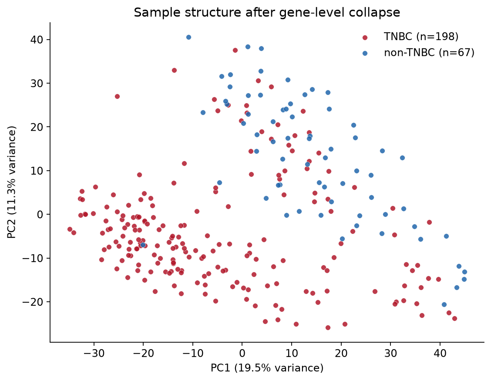
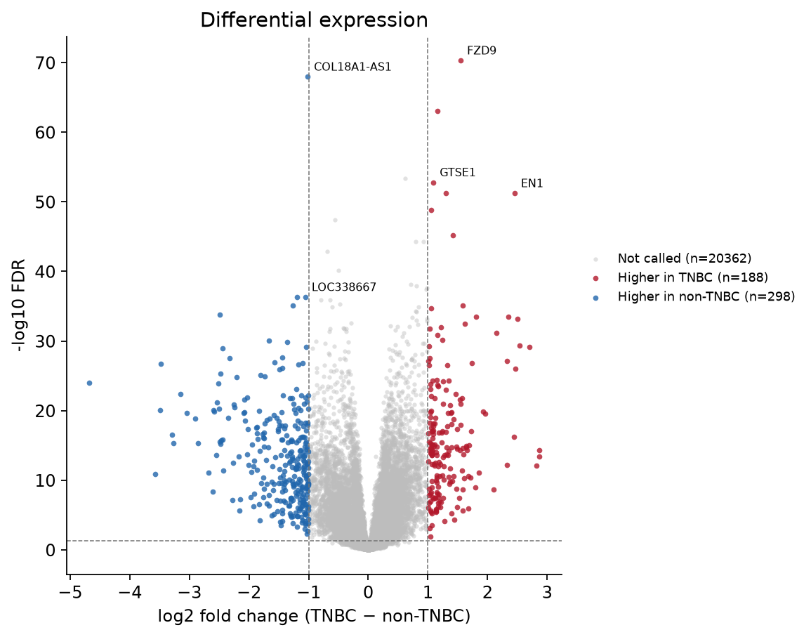

# TNBC transcriptomic biomarker analysis

[](LICENSE)

[](https://github.com/Ishitta-Sarkar/ai-biomarker-discovery/actions/workflows/ci.yml)

Reanalysis of public GEO series **GSE76275**: which genes differ between triple-negative and non-triple-negative breast tumors, which pathways those genes enrich for, and how an elastic-net logistic classifier compares with an L2 logistic model and a majority-class baseline under nested cross-validation.

This is a standalone analysis of a public microarray cohort. It is not an external validation and it is not a clinical test.

## Question

In the Affymetrix HG-U133 Plus 2.0 profiles deposited as GSE76275, which genes have a reproducible expression difference between TNBC and non-TNBC tumors, and can a linear classifier recover the submitted label inside this cohort?

## Data

| Item | Record |
| --- | --- |
| SuperSeries | [GSE76275](https://www.ncbi.nlm.nih.gov/geo/query/acc.cgi?acc=GSE76275) |
| TNBC subseries | [GSE76124](https://www.ncbi.nlm.nih.gov/geo/query/acc.cgi?acc=GSE76124), 198 tumors |
| Non-TNBC subseries | [GSE76274](https://www.ncbi.nlm.nih.gov/geo/query/acc.cgi?acc=GSE76274), 67 tumors |
| Platform | [GPL570](https://www.ncbi.nlm.nih.gov/geo/query/acc.cgi?acc=GPL570), Affymetrix HG-U133 Plus 2.0 |
| Annotation file date | Aug 09 2016, read from the downloaded GEO annotation |
| Processing stated by GEO | RMA in the Bioconductor `affy` package. The series matrices are already log2 intensities |
| Cohort paper | Burstein et al., Clinical Cancer Research, 2015, PMID [25208879](https://pubmed.ncbi.nlm.nih.gov/25208879/) |

The code starts from the GSE76275 accession, reads the SuperSeries record, and downloads each SubSeries matrix and the GPL570 annotation. Those files are cached under `data/raw/` and are not committed. In this cohort the submitted triple-negative field is identical to subseries membership: every GSE76124 sample is TNBC and every GSE76274 sample is non-TNBC. The two matrices were RMA-normalised separately.

## Methods

Defaults live in `src/tnbc_biomarkers/config.py`.

1. **Parse.** Sample characteristics are read cell by cell. GEO does not align those rows by key, so each value is split on the first colon. The label is the submitted `triple-negative status` field (`TN` or `not TN`).
2. **Gene collapse.** Affymetrix control probes (`AFFX*`) are removed. Probes with no symbol, a placeholder symbol, or more than one symbol (`///`) are removed. For each remaining symbol the probe with the highest mean expression is kept. Ties break toward the smaller probe id. This run tested 20,848 genes from 54,675 probes.
3. **QC.** A sample is removed if its median Pearson correlation with the other samples is below 0.80. No sample failed. Principal components are computed on the 2,000 most variable genes after standardisation.
4. **Differential expression.** On the log2 matrix, log2 fold change is the TNBC mean minus the non-TNBC mean. Each gene is tested with a two-sided Welch t-test. P-values are adjusted by Benjamini–Hochberg. A gene is called when FDR ≤ 0.05 and the absolute log2 fold change is at least 1.
5. **Figures.** A volcano plot and a clustered heatmap of row z-scores for the called genes with the smallest FDR (40 genes).
6. **Classification.** The positive class is TNBC. Outer evaluation is 5-fold stratified cross-validation (`random_state` 42). Inside each training fold, genes are ranked by the absolute Welch t statistic on that fold only, and the top 250 are standardised and passed to logistic regression. Inner 5-fold cross-validation selects `C` and, for the elastic net, the L1 ratio, by ROC AUC. Class weights are balanced and the decision threshold is 0.5. The elastic-net grid is `C` in {0.01, 0.1, 1, 10, 100} and `l1_ratio` in {0.15, 0.5, 0.85} (`saga`). The L2 model uses the same features and the same `C` grid (`lbfgs`). The majority-class baseline predicts the training majority label; its score is the training prevalence.
7. **Negative control.** The same elastic net is fit once after permuting the group labels with a NumPy Generator seeded at 43, one more than the analysis seed. That single permutation is not a p-value.
8. **Enrichment.** Genes called in each direction are sent to g:Profiler (`hsapiens`, GO biological process, KEGG, Reactome, g:SCS, custom background of the tested genes). This run queried g:Profiler `e114_eg62_p19_9dc92ac8`.

## Quickstart

```bash
python -m venv .venv
source .venv/bin/activate
python -m pip install -r requirements.txt
python -m pip install -e .
python -m tnbc_biomarkers --cache data/raw --outdir results
pytest
```

The full command downloads the GEO files, writes `results/`, and prints the same text as `results/RESULTS.md`. CI does not download GEO. It lints the package and runs pytest, including the cached 16 × 40 gene matrix in `tests/fixtures/gse76275_subset.csv` taken from this run.

## Results

Numbers below are from one run of the command above. The machine-readable copy is `results/summary.json`. Full tables are in `results/tables/`.



PC1 and PC2 explain 19.5% and 11.3% of the variance. The groups overlap on these two components. Colour is the submitted TNBC label, which is also the subseries label.



Positive log2 fold change means higher in TNBC. Dashed lines are absolute log2 fold change 1 and FDR 0.05. Grey points are not called. The legend counts are 188 genes higher in TNBC, 298 higher in non-TNBC, and 20,362 not called.


Row z-scores. The colour bar is the submitted group.

The run kept all 265 tumors (198 TNBC, 67 non-TNBC). Median pairwise correlation of the retained samples ranged from 0.856 to 0.930 (median 0.911). Expression ranged from 3.43 to 15.62 (median 7.73) and was analysed as the submitted log2 RMA matrix. Among 248 samples with ER, PR, and HER2 all recorded, the receptor pattern matched the submitted triple-negative field in every case.

At FDR ≤ 0.05 and absolute log2 fold change ≥ 1, **486** genes were called (188 higher in TNBC, 298 higher in non-TNBC). Without the fold-change filter, 12,897 genes had FDR ≤ 0.05. The median Welch–Satterthwaite degrees of freedom was 126.5. The smallest FDR was 5.291e-71 for **FZD9** (log2 fold change 1.55, probe `207639_at`).

| Gene | log2 fold change | FDR | Higher in | Called | Probe |
| --- | ---: | ---: | --- | --- | --- |
| FZD9 | 1.55 | 5.291e-71 | TNBC | yes | 207639_at |
| COL18A1-AS1 | -1.01 | 1.137e-68 | non-TNBC | yes | 1564017_at |
| SKA1 | 1.17 | 9.298e-64 | TNBC | yes | 217640_x_at |
| MIR924HG | 0.62 | 3.998e-54 | TNBC | no | 240365_at |
| GTSE1 | 1.09 | 1.684e-53 | TNBC | yes | 211040_x_at |
| ORC1 | 1.30 | 6.258e-52 | TNBC | yes | 205085_at |
| EN1 | 2.46 | 6.258e-52 | TNBC | yes | 220559_at |
| DBF4B | 1.06 | 1.518e-49 | TNBC | yes | 238508_at |

Called means both thresholds were met. MIR924HG has a small FDR and a log2 fold change of 0.62, so it is not called.

Nested cross-validation, with TNBC as the positive class:

| Model | Pooled ROC AUC | Mean fold ROC AUC (SD) | Mean balanced accuracy (SD) | Mean accuracy (SD) | Mean F1 (SD) |
| --- | ---: | ---: | ---: | ---: | ---: |
| Elastic net | 1.000 | 1.000 (0.000) | 1.000 (0.000) | 1.000 (0.000) | 1.000 (0.000) |
| L2 logistic regression | 1.000 | 1.000 (0.000) | 1.000 (0.000) | 1.000 (0.000) | 1.000 (0.000) |
| Majority-class baseline | 0.488 | 0.500 (0.000) | 0.500 (0.000) | 0.747 (0.010) | 0.855 (0.007) |

The baseline accuracy of 0.747 is the rate from always predicting TNBC, the majority class (198/265). Its balanced accuracy is 0.500. Inside a fold the baseline score is constant, so the fold ROC AUC is 0.500. The pooled baseline AUC is 0.488 because the score is the training prevalence, which was 0.745 in three folds and 0.750 in two. One label permutation of the elastic net had pooled ROC AUC 0.476.

Every outer fold selected elastic-net `C` 0.01 and `l1_ratio` 0.15, the smallest value of each grid. The model kept a mean of 127.8 non-zero coefficients out of 250 selected genes. 95 genes were non-zero in every fold. The first 15, ordered by mean absolute coefficient, were COL18A1-AS1, FZD9, C5orf49, LOC101930608, CACNG4, TMEM75, GRIK3, GTSE1, E2F1, HEXA-AS1, ATP11A-AS1, SLC25A21-AS1, MIR4435-2HG, DEFB132, and DMPK.

g:Profiler returned 104 terms for the 188 genes higher in TNBC and 7 terms for the 298 genes higher in non-TNBC. The background was the 20,848 tested genes. Leading terms:

| Direction | Source | Term | ID | p-value | Intersection | Term size |
| --- | --- | --- | --- | ---: | ---: | ---: |
| Higher in TNBC | GO:BP | epithelium development | GO:0060429 | 1.698e-07 | 39 | 1137 |
| Higher in TNBC | KEGG | Cell cycle | KEGG:04110 | 3.828e-07 | 13 | 156 |
| Higher in TNBC | KEGG | Cadherin signaling | KEGG:04519 | 1.325e-06 | 18 | 359 |
| Higher in TNBC | REAC | Formation of the cornified envelope | REAC:R-HSA-6809371 | 1.397e-06 | 11 | 98 |
| Higher in TNBC | GO:BP | mitotic cell cycle | GO:0000278 | 6.367e-06 | 31 | 838 |
| Higher in non-TNBC | GO:BP | response to endogenous stimulus | GO:0009719 | 0.002 | 47 | 1386 |
| Higher in non-TNBC | KEGG | AMPK signaling pathway | KEGG:04152 | 0.005 | 9 | 117 |
| Higher in non-TNBC | KEGG | Hormone signaling | KEGG:04081 | 0.007 | 12 | 212 |
| Higher in non-TNBC | GO:BP | cellular response to endogenous stimulus | GO:0071495 | 0.008 | 41 | 1167 |
| Higher in non-TNBC | GO:BP | mammary gland alveolus development | GO:0060749 | 0.015 | 6 | 20 |

The run took 28.7 seconds after the GEO files were cached.

## Limitations

- **The label is confounded with subseries.** GSE76124 is entirely TNBC and GSE76274 is entirely non-TNBC, and the submitted matrices were RMA-normalised separately. Differential expression and the perfect internal AUC can mix tumor biology with series effects. The PCA plot does not show two cleanly separated clouds. A perfect nested-CV score inside this cohort is not evidence that the classifier would travel to a new study.
- **There is no healthy-tissue arm and no external test set.** The contrast is TNBC versus other breast tumors from the same SuperSeries.
- **Most of the transcriptome is FDR-significant.** 12,897 of 20,848 genes have FDR ≤ 0.05. The fold-change filter is what reduces the call set to 486 genes. With a shift this broad, a small p-value on its own is a weak claim about a specific biomarker.
- **The elastic net does not beat L2 logistic regression here.** Both have pooled ROC AUC 1.000. The selected `C` and `l1_ratio` sit on the edge of the pre-specified grids, and a typical fold keeps about half of the 250 input genes.
- **Probe collapse is incomplete.** Multi-mapped probes were dropped rather than resolved, and the representative probe is the one with the highest mean, not a specificity score. Some called probes are `_x_at` design probes (for example SKA1 `217640_x_at`). Symbols come from the August 2016 GPL570 annotation and include non-coding loci.
- **Tests are Welch t-tests, not empirical-Bayes moderated statistics.** The median residual degrees of freedom is 126.5, so moderation would move the variance estimates less than it would in a small study, but the p-values are still unmoderated.
- **Enrichment is one query of g:Profiler** at version `e114_eg62_p19_9dc92ac8` (timestamp 2026-11-24T16:17:33.749516+00:00). A later database build can change terms and p-values.
- **The label permutation was done once.** It checks that a shuffled label does not also produce ROC AUC 1. It is not a null distribution.

## Layout

```text
src/tnbc_biomarkers/    analysis package
tests/                  unit tests and the cached GSE76275 subset
results/                tables, figures, summary.json, RESULTS.md
.github/workflows/ci.yml
requirements.txt        pinned environment
```

## Citation

If you use this analysis, cite the software metadata in [CITATION.cff](CITATION.cff) and the cohort paper:

Burstein MD, Tsimelzon A, Poage GM, Covington KR, Contreras A, Fuqua SAW, Savage MI, Osborne CK, Hilsenbeck SG, Chang JC, Mills GB, Lau CC, Brown PH. Comprehensive genomic analysis identifies novel subtypes and targets of triple-negative breast cancer. *Clinical Cancer Research*. 2015;21(7):1688-1698. doi:10.1158/1078-0432.CCR-14-0432. PMID: 25208879.

The GEO record also lists PMID 26921331.

## Author

Ishitta Sarkar · [ORCID 0009-0008-1028-6010](https://orcid.org/0009-0008-1028-6010)

M.Tech in Bioinformatics (in progress, expected 2028).

B.Tech Biotechnology (Honours), Dr. A.P.J. Abdul Kalam Technical University, 2022–2026.

MIT License.
