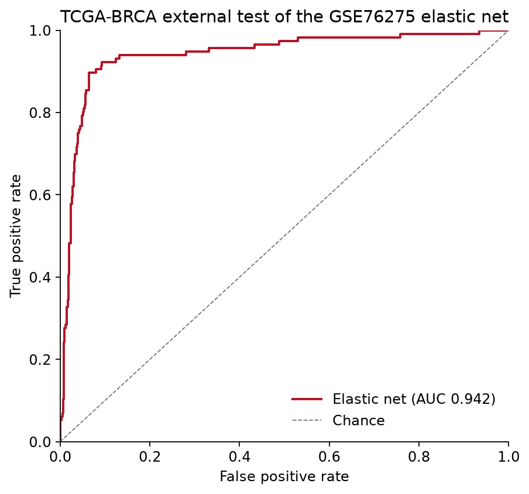
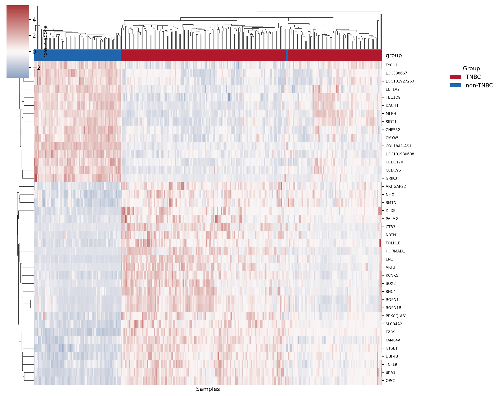

# TNBC transcriptomic biomarker analysis

[](LICENSE)

[](https://github.com/Ishitta-Sarkar/ai-biomarker-discovery/actions/workflows/ci.yml)

Which genes differ between triple-negative and non-triple-negative breast tumors, and does that signal hold in a cohort where both groups were processed together?

Discovery uses public GEO series GSE76275. The label in that series is the same partition as the subseries, and the two matrices were normalised separately, so its internal classifier scores are confounded with batch. The numbers below therefore lead with TCGA-BRCA, a single RNA-seq matrix. This is a reanalysis of public data, not a clinical test.

## Question

Do genes called between TNBC and non-TNBC in GSE76275 keep their direction in TCGA-BRCA, and can an elastic net trained on GSE76275 rank TCGA-BRCA tumors? Separately, what accuracy does the same nested cross-validation reach inside TCGA-BRCA, where the label is not a processing batch?

## Data

| Item | Record |
| --- | --- |
| Discovery SuperSeries | [GSE76275](https://www.ncbi.nlm.nih.gov/geo/query/acc.cgi?acc=GSE76275) |
| TNBC subseries | [GSE76124](https://www.ncbi.nlm.nih.gov/geo/query/acc.cgi?acc=GSE76124), 198 tumors |
| Non-TNBC subseries | [GSE76274](https://www.ncbi.nlm.nih.gov/geo/query/acc.cgi?acc=GSE76274), 67 tumors |
| Discovery platform | [GPL570](https://www.ncbi.nlm.nih.gov/geo/query/acc.cgi?acc=GPL570), Affymetrix HG-U133 Plus 2.0. Annotation file date Aug 09 2016 |
| Discovery processing | RMA in the Bioconductor `affy` package, already log2. The two subseries were normalised separately |
| External cohort | TCGA-BRCA primary tumors, [UCSC Xena HiSeqV2](https://tcga.xenahubs.net/download/TCGA.BRCA.sampleMap/HiSeqV2.gz) |
| External processing | log2(normalized RSEM count + 1), one matrix for the whole BRCA cohort |
| External labels | [Xena clinical matrix](https://tcga.xenahubs.net/download/TCGA.BRCA.sampleMap/BRCA_clinicalMatrix): ER, PR, and HER2 immunohistochemistry |
| Cohort paper for GSE76275 | Burstein et al., Clinical Cancer Research, 2015, PMID [25208879](https://pubmed.ncbi.nlm.nih.gov/25208879/) |

TNBC in TCGA-BRCA means ER, PR, and HER2 IHC were all Negative. non-TNBC means each of the three was Positive or Negative and at least one was Positive. Equivocal and indeterminate HER2 calls were excluded. Downloads are cached under `data/raw/` and are not committed.

## Results

Numbers are from one run. The machine-readable copy is `results/summary.json`. The written results summary is `results/RESULTS.md`.

### TCGA-BRCA, processed as one cohort

721 primary tumors had expression and a complete IHC call: **116 TNBC and 605 non-TNBC**, 20,530 genes. None failed the median pairwise correlation filter (range 0.866–0.951, median 0.935). Expression ran from 0.00 to 20.81 (median 7.60).

Nested cross-validation inside this cohort, with the same 5×5 folds, 250 genes, and penalty grids as the discovery model:

| Model | Pooled ROC AUC | Mean fold ROC AUC (SD) | Mean balanced accuracy (SD) | Mean accuracy (SD) | Mean F1 (SD) |
| --- | ---: | ---: | ---: | ---: | ---: |
| Elastic net | 0.963 | 0.963 (0.024) | 0.918 (0.037) | 0.932 (0.029) | 0.811 (0.075) |
| L2 logistic regression | 0.960 | 0.960 (0.026) | 0.924 (0.044) | 0.931 (0.036) | 0.813 (0.088) |
| Majority-class baseline | 0.497 | 0.500 (0.000) | 0.500 (0.000) | 0.839 (0.003) | 0.000 (0.000) |

F1 is for the TNBC class. The majority class is non-TNBC, so the baseline F1 is 0. The baseline accuracy of 0.839 is 605/721. Across outer folds the elastic net selected C values 0.01 and 0.10 and l1_ratio values 0.15, 0.50, and 0.85.



The locked elastic net was trained only on GSE76275 (top 250 shared genes by absolute Welch t, then inner cross-validation) and applied to TCGA-BRCA after z-scoring each gene inside its own cohort. It selected C 0.01 and l1_ratio 0.15, with 114 non-zero coefficients.

| External score | ROC AUC | Balanced accuracy | Accuracy | F1 |
| --- | ---: | ---: | ---: | ---: |
| Elastic net trained on GSE76275 | 0.942 | 0.532 | 0.215 | 0.291 |
| Predict the TCGA-BRCA majority class | 0.500 | 0.500 | 0.839 | 0.000 |
| Predict the GSE76275 majority class (TNBC) | 0.500 | 0.500 | 0.161 | 0.277 |

The ranking transfers (ROC AUC 0.942). The 0.5 probability cut does not: TNBC is 116 of 721 external tumors and 198 of 265 discovery tumors, and the cut was not re-fit on TCGA-BRCA. Balanced accuracy at that cut is 0.532.

On the same call rule (FDR ≤ 0.05 and absolute log2 fold change ≥ 1), TCGA-BRCA called 2,636 genes (1,361 higher in TNBC, 1,275 higher in non-TNBC). 13,650 genes had FDR ≤ 0.05 with no fold-change filter.

Of the **486** GSE76275 calls, **448** were measured in TCGA-BRCA. **447** had the same log2 fold-change sign. **445** had the same sign and FDR ≤ 0.05. **394** had the same sign and also absolute log2 fold change ≥ 1.

### GSE76275 internal result, confounded with batch

Every GSE76124 sample is TNBC and every GSE76274 sample is non-TNBC. The matrices were RMA-normalised separately. Nested cross-validation inside GSE76275 is therefore not an estimate of performance on a new batch.

| Model | Pooled ROC AUC | Mean balanced accuracy (SD) | Mean accuracy (SD) |
| --- | ---: | ---: | ---: |
| Elastic net | 1.000 | 1.000 (0.000) | 1.000 (0.000) |
| L2 logistic regression | 1.000 | 1.000 (0.000) | 1.000 (0.000) |
| Majority-class baseline | 0.488 | 0.500 (0.000) | 0.747 (0.010) |

The baseline accuracy 0.747 is 198/265. Its within-fold ROC AUC is 0.500. The pooled baseline AUC is 0.488 because each fold's score is that fold's training prevalence. One label permutation of the elastic net had pooled ROC AUC 0.476. Every outer fold selected C 0.01 and l1_ratio 0.15. Mean non-zero coefficients: 127.8 of 250.

The discovery differential expression, which uses the same confounded partition, tested 20,848 genes in 265 tumors. At FDR ≤ 0.05 and absolute log2 fold change ≥ 1 it called 486 genes (188 higher in TNBC, 298 higher in non-TNBC). Without the fold-change filter, 12,897 genes had FDR ≤ 0.05. The median Welch–Satterthwaite degrees of freedom was 126.5. The smallest FDR was 5.291e-71 for FZD9 (log2 fold change 1.55, probe `207639_at`). No sample failed the correlation filter (median pairwise correlation 0.856–0.930). Among 248 samples with ER, PR, and HER2 all recorded, the receptor pattern matched the submitted triple-negative field in every case. PC1 and PC2 of the 2,000 most variable genes explained 19.5% and 11.3% of the variance and do not separate the groups cleanly.





g:Profiler `e114_eg62_p19_9dc92ac8` (timestamp 2026-11-24T16:25:37.683279+00:00) returned 104 terms for genes higher in TNBC and 7 for genes higher in non-TNBC. The leading KEGG terms were Cell cycle (p = 3.828e-07) and AMPK signaling pathway (p = 0.005).

The run took 72.0 seconds after the public files were cached.

## Methods

Defaults live in `src/tnbc_biomarkers/config.py`.

1. **Discovery labels.** The GSE76275 accession is fetched, its SuperSeries record is parsed, and each subseries matrix is downloaded. Sample characteristics are read cell by cell. The label is the submitted `triple-negative status` field.
2. **Gene collapse.** Control probes (`AFFX*`), probes without one gene symbol, and multi-symbol probes are removed. The probe with the highest mean is kept for each symbol.
3. **QC.** A sample is removed if its median Pearson correlation with the other samples is below 0.80.
4. **Differential expression.** Log2 fold change is the TNBC mean minus the non-TNBC mean. Each gene gets a two-sided Welch t-test and a Benjamini–Hochberg FDR. A call requires FDR ≤ 0.05 and absolute log2 fold change ≥ 1.
5. **External labels.** TCGA-BRCA HiSeqV2 and the Xena clinical matrix are downloaded. Primary tumors only. TNBC is ER-negative, PR-negative, and HER2-IHC-negative. Equivocal and indeterminate HER2 calls are dropped.
6. **Transfer.** On GSE76275, genes shared with TCGA-BRCA are ranked by absolute Welch t and the top 250 are kept. An elastic net is tuned by inner 5-fold ROC AUC on that discovery matrix only. Each gene is then z-scored inside GSE76275 and, separately, inside TCGA-BRCA. Coefficients learned in discovery z-score units are applied to the external z-scores. The probability cut stays at 0.5.
7. **Within-batch model.** The same nested cross-validation used for discovery is run on TCGA-BRCA alone. Scaling there is the training-fold standardisation applied to the test fold, not a second per-cohort z-score.
8. **Replication.** A discovery call replicates in direction when the TCGA-BRCA log2 fold change has the same sign. Significance is FDR ≤ 0.05. The stricter count also requires absolute log2 fold change ≥ 1.
9. **Enrichment.** Discovery calls in each direction are sent to g:Profiler (GO biological process, KEGG, Reactome, g:SCS, background of the tested genes).

## Quickstart

```bash
python -m venv .venv
source .venv/bin/activate
python -m pip install -r requirements.txt
python -m pip install -e .
python -m tnbc_biomarkers --cache data/raw --outdir results
pytest
```

CI lints the package and runs pytest, including a cached 16 × 40 subset of the GSE76275 gene matrix. It does not download GEO or TCGA.

## Limitations

- The GSE76275 nested-CV ROC AUC of 1.000 is an internal score on a label that is identical to subseries. It is not evidence that the classifier survives a new batch.
- TCGA-BRCA is RNA-seq and GSE76275 is microarray. The transfer z-scores each gene inside the cohort being scaled. That uses the external sample distribution, not the external labels.
- The external probability cut was left at 0.5. With TNBC prevalence 0.747 in discovery and 0.161 in TCGA-BRCA, balanced accuracy at that cut is 0.532 even though the ROC AUC is 0.942.
- Thirty-eight of the 486 discovery calls had no matching Hugo symbol in HiSeqV2. Matching was exact.
- HER2 IHC equivocal tumors were excluded, so the external contrast is cleaner than a clinical HER2 call that uses FISH to resolve 2+ stains.
- TCGA-BRCA can still carry plate and site effects. Those effects are not the same thing as normalising the two classes in separate matrices.
- Welch tests are unmoderated. g:Profiler results are for database build `e114_eg62_p19_9dc92ac8`. The label permutation was done once and is not a null distribution.

## Layout

```text
src/tnbc_biomarkers/    discovery, TCGA-BRCA fetch, transfer, and replication
tests/                  unit tests and the cached GSE76275 subset
results/                tables, figures, summary.json, RESULTS.md
```

## Citation

If you use this analysis, cite [CITATION.cff](CITATION.cff) and the discovery cohort paper:

Burstein MD, Tsimelzon A, Poage GM, Covington KR, Contreras A, Fuqua SAW, Savage MI, Osborne CK, Hilsenbeck SG, Chang JC, Mills GB, Lau CC, Brown PH. Comprehensive genomic analysis identifies novel subtypes and targets of triple-negative breast cancer. *Clinical Cancer Research*. 2015;21(7):1688-1698. doi:10.1158/1078-0432.CCR-14-0432. PMID: 25208879.

The GEO record also lists PMID 26921331. TCGA-BRCA expression and clinical fields were read from the UCSC Xena data hub.

## Author

Ishitta Sarkar · [ORCID 0009-0008-1028-6010](https://orcid.org/0009-0008-1028-6010)

M.Tech in Bioinformatics (in progress, expected 2028).

B.Tech Biotechnology (Honours), Dr. A.P.J. Abdul Kalam Technical University, 2022–2026.

MIT License.
